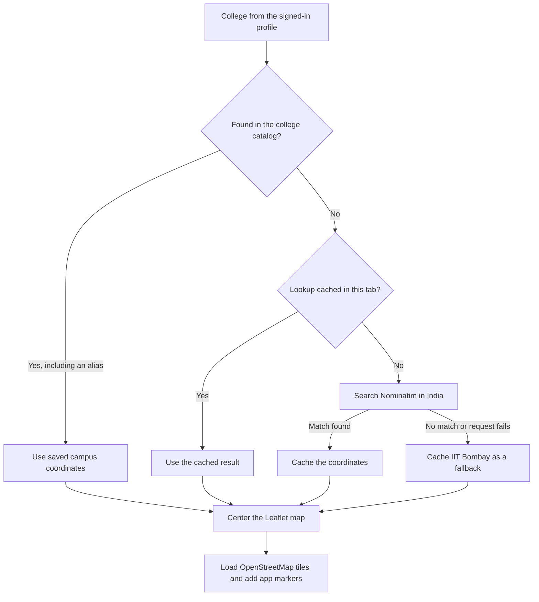

# UniBuddy

**Practical guidance from seniors, and a clearer start to college life.**

UniBuddy is a mentorship and campus discovery app for Indian college students. It brings together three things students often have to find separately: someone experienced to ask for advice, a map of their campus surroundings, and a way to share everyday college life.

The idea is to help a junior find a senior who has already worked through a similar challenge, even if that senior studies at another college. A student looking for help with their first project, a resume, interview preparation, or a learning roadmap can find someone with relevant experience and start a conversation.

**Current status:** this repository contains an interactive React frontend prototype. Profiles, connections, messages, and uploaded stories are stored in the browser. The campus map loads real OpenStreetMap tiles. A shared backend, verified student identities, and paid bookings are future work.

## The problem

Starting college involves more than attending classes. Students have questions such as:

- Where should I start with programming, data structures, or building projects?
- Who can give feedback on my particular resume or portfolio?
- How do students at other colleges prepare for internships and placements?
- Where can I find places to eat, study, stay, or work out near campus?
- How do I meet people and feel connected to college life?

Advice is often scattered across friends, group chats, videos, and expensive mentoring services. A student's immediate circle may have limited experience with the thing they want to learn. General online content can explain a topic, but personal feedback requires a conversation.

UniBuddy aims to make that conversation easier to start, while giving students a shared place to explore and participate in campus life. The wider product idea includes affordable one-to-one mentoring sessions; the current implementation supports free connection and messaging flows within the local prototype.

## What the app offers

There are two roles: **juniors**, who are looking for guidance, and **seniors**, who want to share their experience.

| Feature | What a student can do |
| --- | --- |
| Mentor discovery | Juniors search seniors by name, skill, or college; filter by skill, college, year, and rating; and inspect profiles, sample reviews, and session prices. |
| Campus Circle | Juniors manage connected seniors, incoming requests, sent requests, and discovery from the Connections page. |
| Senior workspace | Seniors edit their mentor profile, choose skills, set availability, review incoming requests, and open recent conversations. |
| Messaging | An accepted junior–senior connection unlocks chat, with an inbox, request handling, unread counts, sent/seen indicators, emoji, and multiline messages. |
| Campus map | The map opens around the college saved in the user's profile, with zoom, a campus marker, nearby-place categories, and a recenter button. |
| Campus stories | Both roles browse a swipeable photo/video feed and use the **+** button to compose a story with a media preview and an optional caption. |

The interface supports light and dark themes, desktop navigation, mobile bottom tabs, and shared dialogs and drawers. Seniors handle connection requests through their dashboard and inbox; the separate Connections page is available to juniors.

### A typical journey

Imagine a first-year student at Newton School of Technology who wants to build a first web project. They register with their college and interests, filter the mentor directory for Web Dev or React, and send a connection request to a senior. Once the senior accepts, they can exchange messages. The student can also open the map around the Sonipat campus and post a photo from college on the Stories page.

This journey can be explored with demo accounts in one browser. Connecting students on separate devices will require the shared backend described below.

## How OpenStreetMap is used

[OpenStreetMap](https://www.openstreetmap.org/) is a community-maintained geographic database. UniBuddy uses its standard map tiles to display roads, buildings, and other mapped features around a student's college.

The app displays different campuses by moving the center of the same interactive map. Each college has a latitude and longitude; Leaflet requests the tiles needed for that location and zoom level as the user explores.

### The pieces involved

| Piece | Responsibility |
| --- | --- |
| OpenStreetMap tiles | Provide the geographic map imagery. |
| [Leaflet](https://leafletjs.com/) | Displays the map and handles panning, zooming, markers, tooltips, and popups. |
| [React Leaflet](https://react-leaflet.js.org/) | Connects Leaflet to React through components such as `MapContainer`, `TileLayer`, and `Marker`. |
| [College catalog](src/data/colleges.js) | Stores campus coordinates and alternate college names for all 25 listed colleges. |
| [Location resolver](src/lib/geocode.js) | Matches the profile's college to the catalog, or looks up an unlisted name. |
| [Nominatim](https://nominatim.org/) | Searches OpenStreetMap data to turn an unfamiliar college name into coordinates. |

### From a college name to a map



1. **Read the profile.** The Map page uses the college entered during registration or saved in the user's profile.
2. **Try the catalog first.** Matching ignores case, spaces, and punctuation and recognizes configured aliases. For example, `LPU` and `Lovely Professional University` resolve to the same campus. All 25 listed colleges have saved coordinates, so these names do not need a geocoding request.
3. **Look up custom names when needed.** For an unlisted college, the resolver calls Nominatim's search endpoint with `countrycodes=in` and `limit=1`. The fetch has a six-second timeout. Completed results, including fallbacks, are cached in memory for the current tab until a full reload. The registration dropdown searches the local catalog; typing in it does not call Nominatim.
4. **Handle an unsuccessful lookup.** The map uses IIT Bombay as a sample campus and displays a fallback notice. Loading failures for map tiles have a separate retry control.
5. **Render the campus.** The map starts at zoom level `16`, adds the college marker and app-provided place markers, and updates its center when the profile's college changes.

Some college names need an explicit campus choice. The catalog currently uses:

| College entry | Campus used |
| --- | --- |
| Newton School of Technology | Rishihood University, Sonipat |
| Vedam School of Tech | Sushant University, Gurugram |
| Symbiosis Pune | Symbiosis Institute of Technology, Lavale, Pune |
| SRM University | Kattankulathur campus, Tamil Nadu |

The complete list, aliases, coordinates, and recorded OpenStreetMap source links are in [colleges.js](src/data/colleges.js). Adding a campus with saved coordinates to this catalog makes it available to the registration list and the map resolver.

### Where the map images come from

The default tile URL is:

```text
https://tile.openstreetmap.org/{z}/{x}/{y}.png
```

A tile is a small square image covering part of the map. In this URL, `z` is the zoom level, and `x` and `y` identify the tile's position in the map grid. Leaflet combines the visible tiles into the map and requests different ones when the user pans or zooms. IIT Bombay and the other colleges all use this same tile service.

The default configuration requires no API key. Internet access is still needed to fetch tiles and to look up unlisted colleges.

### Where the nearby-place pins come from

The app adds a separate layer of nearby places from [places.js](src/data/places.js). It contains **eight sample spots**, with names, categories, ratings, reviews, walking times, and offsets measured east/north from the campus center.

The [coordinate helper](src/lib/geo.js) converts those meter offsets into latitude and longitude. The same sample collection is positioned around whichever college is selected. Selecting a card highlights its marker, and users can filter by Food, Study, Stay, or Fitness and sort by rating or walking time.

**These place pins, reviews, and walking times are illustrative data.** They are not retrieved from OpenStreetMap or calculated from actual walking routes. Real recommendations would need a collection of places and reviews specific to each college, with accurate coordinates.

### Map configuration and attribution

The defaults work without an environment file. To configure another tile provider, start with [.env.example](.env.example):

```bash
cp .env.example .env.local
```

| Variable | Purpose |
| --- | --- |
| `VITE_MAP_TILE_URL` | Tile URL template; defaults to the OpenStreetMap URL above. |
| `VITE_MAP_ATTRIBUTION` | Attribution HTML shown on the map; defaults to a link crediting OpenStreetMap contributors. |

Restart the development server after changing these values. Vite embeds `VITE_` variables in the browser bundle, so these settings are public.

OpenStreetMap attribution remains visible on the map. Use of the public services must follow the [tile usage policy](https://operations.osmfoundation.org/policies/tiles/) and [Nominatim usage policy](https://operations.osmfoundation.org/policies/nominatim/). The current cache is per tab and does not enforce an application-wide request limit. A larger deployment would need providers and shared request controls suited to its traffic.

## How stories work

Both juniors and seniors can open **Stories**, press **+**, select a photo or video up to **20 MB**, preview it, and add an optional caption of up to **280 characters**. The composer checks the file type, size, and whether the browser can load the preview before enabling submission.

Uploaded media and its author, college, caption, and creation time are saved in **IndexedDB**, the browser's database for larger structured data and files. The feed creates temporary object URLs to display the saved media and releases them when they are no longer needed.

Posts are loaded newest first for the user's college, using the same college aliases as the map. They appear before the eight bundled example stories. Uploads survive reloads, and both roles can view posts for the same college in the same browser. Other devices do not receive these files, and there is no automatic 24-hour expiry.

The feed includes swipe navigation, video playback, likes, comments, and share controls. Likes and comments are held in page state and reset when the page is reloaded or reopened. Sharing sends the Stories page URL; it does not publish the locally stored media to a server. Report and mute actions currently display confirmation messages only.

## Architecture and data storage

UniBuddy is a single-page application: React renders the interface, React Router selects the page, and React Context shares profile and network state between components.

| Technology | Use in this project |
| --- | --- |
| React 18 | Pages, reusable components, forms, and interactive state. |
| Vite 5 | Local development server and production builds. |
| React Router 6 | Navigation and role-specific page access. |
| Leaflet 1.9 + React Leaflet 4 | Campus maps and map interactions. |
| Framer Motion 11 | Story gestures, transitions, and interface animations. |
| Lucide React | Icons. |
| Plain CSS and CSS custom properties | Page layouts, shared design tokens, responsive styles, and themes. |
| Browser localStorage + IndexedDB | Local profiles, messages, settings, and uploaded stories. |
| ESLint + Node.js test runner | Code checks and tests for college resolution and connection rules. |

[AuthContext](src/context/AuthContext.jsx) manages the current profile and login/register dialogs. [NetworkContext](src/context/NetworkContext.jsx) manages profiles, requests, connections, and messages. [ToastContext](src/context/ToastContext.jsx) displays temporary feedback messages.

Connection rules live in [network.js](src/lib/network.js). A request must join a junior and a senior, the recipient must accept it before messaging opens, and only participants can act on that connection through the application logic. Pausing a senior's availability stops new incoming requests while existing conversations stay usable. Removing a connection also removes its local message history. These rules run in the browser; a deployed multi-user service would need server-side enforcement.

### What is saved

| Storage | Key or database | Contents |
| --- | --- | --- |
| localStorage | `unibuddy_user` | The active profile, restored on reload. |
| localStorage | `unibuddy_accounts_v1` | Registered and previously used profiles. |
| localStorage | `unibuddy_network_v1` | Network profiles, connections, requests, and sent messages. |
| localStorage | `unibuddy-theme` | Light/dark preference. |
| IndexedDB | `unibuddy_stories_v1`, store `stories` | Uploaded story files and metadata, indexed by college. |

Message drafts stay in React state while switching conversations within the inbox. Story likes/comments and the custom-college geocoding cache also use memory rather than persistent storage.

Network changes synchronize between tabs through the browser's `storage` event. Browser data belongs to the site's origin: a different device, browser, hostname, or port has separate data. For example, the development server and production preview normally use different ports and therefore different local data. Clearing the site's browser storage removes its saved profiles, conversations, and uploads.

### Authentication in the prototype

Registration validates the form and creates a local profile. Login finds a saved or demo profile by email. The password field requires at least six characters for the form to submit, but passwords are never saved, transmitted, or checked against an account credential. College email ownership and student identity are not verified.

Role checks control which screens the interface opens. They demonstrate the intended junior/senior experience; they are not a substitute for backend authentication and authorization.

## Run locally

Use a supported Node.js LTS release, with **Node.js 22 or newer recommended**, and npm.

From the repository folder:

```bash
npm ci
npm run dev
```

Open the address printed by Vite, usually [http://localhost:5173](http://localhost:5173). No backend service or API key is needed for the default setup. Map tiles, bundled remote photos/videos, and web fonts need an internet connection.

### Try the demo accounts

Open **Log in** and choose either demo button, or use the following email addresses with any password of six or more characters in the form:

| Role | Profile | Email |
| --- | --- | --- |
| Junior | Rahul Verma, IIT Bombay | `rahul@iitb.ac.in` |
| Senior | Aarav Mehta, IIT Bombay | `aarav@iitb.ac.in` |

The demo includes an existing Rahul–Aarav conversation and three incoming requests for Aarav. The directory begins with 12 sample senior profiles. A new registration gets its own empty set of connections and requests, and a registered senior's profile becomes available in the local mentor directory.

To try a different campus map, register a profile with that college. Seniors can also change their college in **Edit mentor profile** and open `/map`.

To simulate both sides of a chat, sign in as the senior in one tab. In a second tab on the same site, log out and choose the junior demo. Already-open tabs keep their current role while network changes synchronize. Reloading either tab restores the most recently saved active profile.

### Development commands

| Command | Purpose |
| --- | --- |
| `npm run dev` | Start Vite with live updates while editing. |
| `npm run lint` | Run ESLint; warnings are treated as failures. |
| `npm test` | Run the Node.js tests in `tests/`. |
| `npm run build` | Generate the production site in `dist/`. |
| `npm run preview` | Serve the latest production build locally. Run the build first. |

The tests cover local resolution of all listed colleges and aliases, the selected Newton/Vedam campuses, and connection/message rules such as duplicate requests, acceptance, participant checks, unread counts, message length, and removal. They do not exercise the rendered interface, story uploads, or live OpenStreetMap availability.

For deployment, serve `dist/` over HTTPS and configure the host to return `index.html` for application routes such as `/map` and `/stories`. This allows direct links and reloads to work with `BrowserRouter`. Edit the files in `src/` and rebuild; the hashed files in `dist/assets/` are generated output.

## Pages and source structure

| Route | Access | Page |
| --- | --- | --- |
| `/` | Public | Product introduction and registration/login entry points. |
| `/mentors` | Junior | Mentor search and profiles. |
| `/connections` | Junior | Campus Circle and connection management. |
| `/senior` | Senior | Mentorship dashboard. |
| `/senior/profile` | Senior | Mentor profile editor. |
| `/messages` | Junior and senior | Inbox and connection requests. |
| `/messages/:peerId` | Junior and senior | A specific conversation; sending requires an accepted connection. |
| `/map` | Junior and senior | Map centered on the profile's college. |
| `/stories` | Junior and senior | Story feed and composer. |

The map route accepts both roles; its main navigation shortcut is in the junior interface. Senior dashboard request links open `/messages?tab=requests`. Visitors who open protected pages are sent to the homepage with the login dialog; a user opening a page restricted to the other role is sent to their own landing page.

```text
src/
  App.jsx             Route definitions and application providers
  main.jsx            React entry point and initial theme
  components/         Navigation, auth forms, cards, avatars, dialogs, drawers
  context/            AuthContext, NetworkContext, ToastContext
  data/               College catalog and sample mentors, network, places, stories
  lib/                Geocoding, coordinate math, network rules, storage helpers
  pages/
    Home/             Product introduction
    Mentors/          Mentor discovery
    Senior/           Senior dashboard and profile editor
    Connections/      Junior connection management
    Messages/         Inbox and chat
    CampusMap/        Leaflet map and nearby-place interface
    Stories/          Swipeable feed and story composer
  styles/             Shared CSS, design tokens, and themes
public/               Static assets
tests/               College-location and connection-rule tests
vite.config.js       Build configuration and vendor/map/motion chunks
.env.example         Optional map settings
```

## Current scope and next steps

The repository demonstrates the product experience with local persistence. Several visible elements describe capabilities that would need additional services before a public launch:

| Area | Current behavior |
| --- | --- |
| Mentoring sessions | Prices are shown, but **Book** displays a message that booking is coming soon. Scheduling, calls, payments, and payment holding are not implemented. |
| Identity and trust | Demo profiles include verification labels. Email verification and a real student-verification process are not implemented. |
| Community data | Mentor reviews, nearby-place recommendations, bundled stories, and homepage activity figures are sample content. |
| Messaging and uploads | Data stays in the browser. There is no shared server database, cross-device delivery, or remote media hosting. |
| Moderation | Story report/mute buttons show feedback. There is no report queue, review team integration, or persistent author muting. |

To turn this into a shared student service, the main next steps would be backend authentication and college verification, a shared database with access controls, real-time messaging, hosted media with moderation, and actual campus-specific places and reviews. Scheduling and payments could then support the affordable mentoring sessions described in the product vision.
